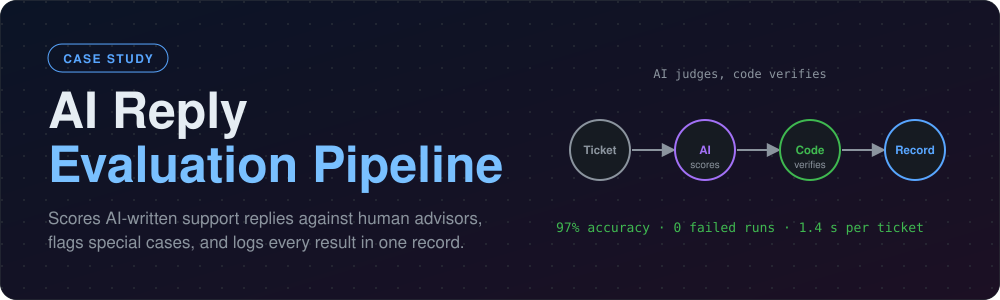
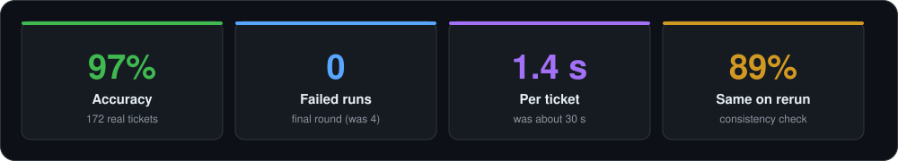
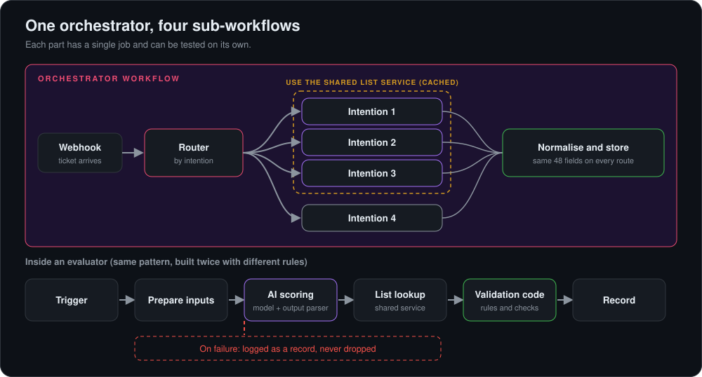
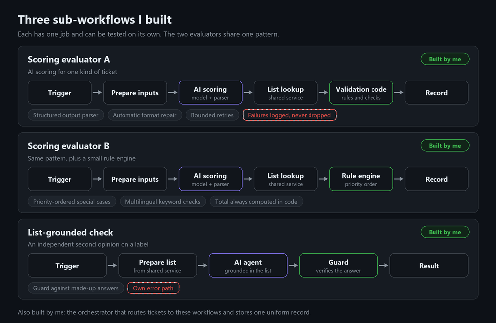
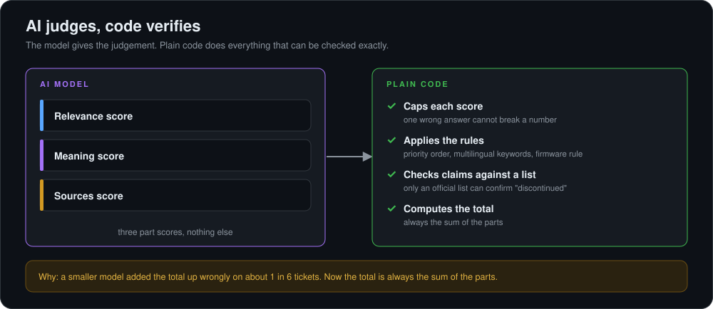
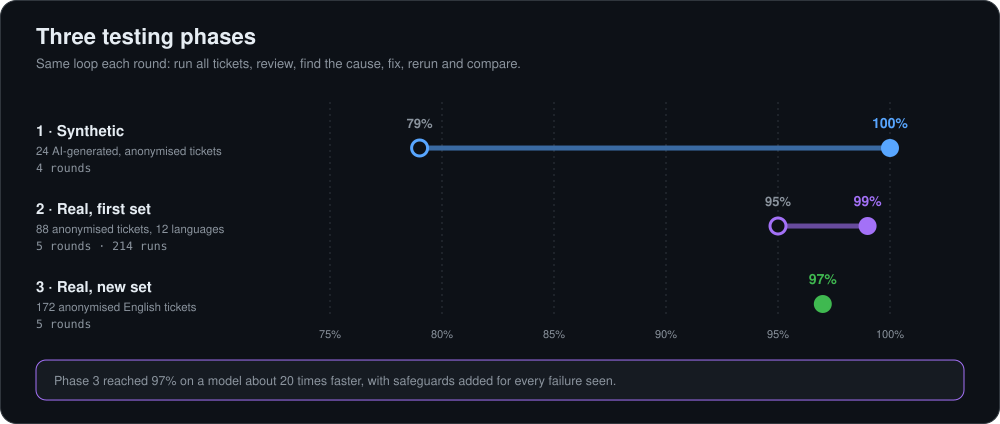
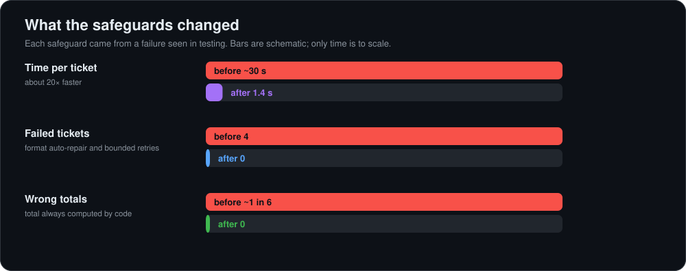

## Contents

[At a glance](#at-a-glance) · [What I built](#what-i-built) · [The problem](#the-problem) · [The solution](#the-solution) · [Architecture](#architecture) · [Design decisions](#design-decisions) · [How I tested it](#how-i-tested-it) · [Results](#results) · [What I learned](#what-i-learned) · [Tech stack](#tech-stack)

---

## At a glance

| | |
|---|---|
| **Problem** | Nobody could measure how good AI-drafted support replies were. Manual review did not scale. |
| **Approach** | n8n workflows: an AI model scores each reply on three parts, and plain code verifies the result. |
| **Result** | **97%** accuracy on 172 real tickets, **0** failed runs, **1.4 s** per ticket (was ~30 s). |
| **Scope** | A showcase of work done at a company. The real project is private. |

> [!NOTE]
> This is a showcase, not the real project (that one is private). It contains no company code, data, prompts or credentials. Only the approach, the design decisions and the results.

## What I built

I built the **orchestrator workflow** and the **three sub-workflows** shown below, designed and wrote the AI scoring prompts and the JavaScript validation code, and designed and ran the test rounds that tuned the system. A fourth, shared sub-workflow provides a cached list lookup that all of them call.

## The problem

A support team drafted replies with AI, but had no way to measure them.

- **Manual review did not scale.**
- **A single average hid tickets that need different treatment**, such as discontinued products or warranty requests.

## The solution

1. A ticket arrives through a **webhook** and is **routed by ticket type**.
2. An AI model **scores it on three parts**: relevance, meaning and sources.
3. **Plain code checks and corrects** the output before the result is stored.
4. Every route writes **one uniform record**.

## Architecture

Not one big workflow: one **orchestrator** calls four smaller, reusable **sub-workflows**. Each has one job and can be tested alone. The two evaluators share one pattern.

  

| Workflow | Job | Techniques it shows |
|---|---|---|
| **Orchestrator** | Receives tickets, routes them, normalises and stores every result | Webhook trigger, switch routing, sub-workflow calls, one normalisation step (same 48 fields on every route), date-partitioned storage keys |
| **Scoring evaluator A** | AI scoring for one kind of ticket | LLM chain with a structured-output parser, automatic format repair, bounded retries, JavaScript validation, error branch that logs failures |
| **Scoring evaluator B** | Same pattern, plus extra rules | A small rule engine in code: priority order for special cases, multilingual keyword checks, a firmware rule, totals always computed by code |
| **List-grounded check** | An independent second opinion on a label | LLM agent grounded in a list, a deterministic guard against made-up answers, a separate error path |
| **Shared list service** | One cached lookup for everyone | Reusable sub-workflow with caching, which removed a per-ticket API call |

**Skills shown:** modular workflow design · prompt and output-schema design · defensive coding around AI output · caching and load awareness · error handling and observability · a measured test strategy.

## Design decisions

| Decision | Why |
|---|---|
| **AI judges, code verifies** | The model gives three part scores. Code caps them and applies the rules, so one wrong answer cannot break a number. |
| **Total computed in code** | A smaller model added up wrongly on about 1 in 6 tickets. Now the total is always the sum of the parts. |
| **Special cases scored apart** | End-of-life, warranty and two-product tickets get a marker score and are left out of averages. |
| **AI claims checked against a list** | The model may flag a special case, but only an official list can confirm it. |
| **Format auto-repair and retries** | Broken model output is repaired automatically. Failed tickets fell from 4 to 0. |
| **One uniform record** | Every route writes the same 48 fields, so reports need no special cases. |

## How I tested it

Every round followed the same loop: **run all tickets → review against the expected result → find the cause (model or rule) → fix with a prompt change or code check → rerun and compare.**

| Phase | Data | Rounds | Result |
|---|---|---|---|
| 1 · Synthetic | 24 AI-generated, anonymised tickets, plus an independent AI review | 4 | Accuracy 79% → 100% |
| 2 · Real, first set | 88 anonymised tickets in 12 languages | 5 (214 runs) | Accuracy 95% → 99%, special cases 2 of 5 → 5 of 5 |
| 3 · Real, new set | 172 anonymised English tickets | 5 | Accuracy 97% on a model about 20× faster |

> [!TIP]
> Later test runs were paced one ticket at a time, with rests between batches and automatic stop rules, so tests could not overload shared services.

## Results

| Metric | Result |
|---|---|
| Accuracy on 172 real tickets | **97%** |
| Failed runs in the final round | **0** |
| Time per ticket | **1.4 s** (was about 30 s) |
| Same result on a rerun | **89%** |

## What I learned

- **Judgement for the model, plain code for anything checkable.**
- **Faster models need more safeguards.** Every safeguard here came from a failure seen in testing.
- **Measure with real data early.** Synthetic tickets passed at 100%, and real tickets still exposed new problems.
- **Pace your tests.** Speed makes it easy to overload shared systems by accident.

## Tech stack

`n8n` · `Amazon Bedrock` · `JavaScript` · `Amazon S3` · `JSON schema output parsing`
